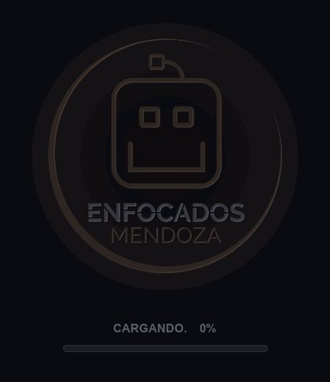

<div align="center">



# 📦 StockDepo — Gestión de Depósito, Armado y Despacho con IA

> **Sistema web local para control de inventario por recetas (BOM), armado de productos, despacho multicanal, previsión de demanda y digitalización de planillas manuscritas mediante IA (FastAPI + SQLite + Gemini Vision).**


</div>

---

## 🎯 ¿Qué es StockDepo?

**StockDepo** es un sistema de gestión de depósito diseñado y construido a medida para **Enfocados Mendoza**, pensado para reemplazar las planillas de papel por una aplicación web ágil, intuitiva y más rápida que anotar a mano.

Corre **100 % de forma local** en una notebook con Windows (sin servidores pagos, sin suscripciones ni dependencia de la nube) y permite que todo el equipo opere en simultáneo desde **celulares o tablets conectados al mismo Wi-Fi**, accediendo con un código QR generado automáticamente por el propio sistema.

---

## ✨ Funcionalidades principales

### 📋 Inventario en 3 niveles y Piezas (BOM / Recetas)
- **Clasificación clara:** separa **Productos de venta** (estuches armados listos para despachar), **Componentes** (piezas y accesorios de armado) e **Insumos de embalaje** (cajas y rollos).
- **Control visual en tiempo real:** barras de nivel, estados (`OK` / `Bajo` / `Crítico`), edición rápida de mínimos y críticos, ajustes `±1` y ordenamiento personalizado (**"Mi orden"** persistente).
- **Gestión de recetas (Piezas que incluye):** cada producto tiene su lista de componentes y caja sugerida por defecto.

### 🛠️ Armado de estuches (por interfaz o por chat)
- Al registrar el armado de un producto (ej. *10 Estuches Asador*), suma el producto terminado y **descuenta automáticamente cada componente según su receta**, alertando si falta alguna pieza.
- **Carga conversacional por chat:** escribiendo en lenguaje natural (por ejemplo, *"armé 10 estuches ferneteros"*), el asistente calcula el impacto exacto en productos y piezas y solicita confirmación antes de impactar el stock.

### 🚚 Despacho multicanal y cálculo inteligente de cajas
- Registro ágil por canal de venta: **Local**, **Revendedor** (con forma de salida: *Terminal de ómnibus*, *Andreani* o *Retira en local*), **Mercado Libre** y **Tienda Nube**.
- **Regla automática y configurable de cajas por cantidad:**
  - `1 a 2 unidades` → **Caja chica**
  - `3 a 9 unidades` → **Caja mediana**
  - `10 o más unidades` → **Caja grande**
- Control práctico de rollos enteros (*cinta, film, burbujas*) mediante checkboxes al finalizar el despacho.

### 📸 Digitalización de planillas en papel con IA + Anti-duplicados
- **Lectura por foto con Gemini Vision:** captura directa desde la cámara del celular o carga de imagen desde la notebook, adaptada a las 3 planillas operativas del negocio (`DIARIA 4 ok`, `Tienda Nube 1` y `Mercado Libre`).
- **Tabla de revisión editable:** nada se descuenta sin confirmación del usuario, mostrando indicadores de confianza (`✅` / `⚠️` / `❗`).
- **Control anti-duplicados por huella:** al fotografiar la misma hoja varias veces durante el día, el sistema identifica cada fila y la clasifica en `🆕 Nueva`, `✔️ Ya cargada`, `✏️ Modificada` o `❓ Posible duplicado` para evitar descuentos repetidos.
- **Generador de planilla imprimible:** descarga directa de la planilla de Mercado Libre lista para imprimir y descarga del Excel base.

### 💬 Asistente Híbrido y Previsión a Futuro
- **Arquitectura híbrida:** utiliza **Google Gemini** (nivel gratuito, con contexto en vivo del inventario) y cambia automáticamente a un **motor local por reglas** cuando no hay conexión a internet o API key configurada.
- **🔮 Simulador «¿Me alcanza?»:** evalúa pedidos futuros en segundos indicando stock actual, stock restante, faltantes, **cuántos estuches adicionales se pueden armar con los componentes disponibles**, qué piezas faltan comprar y cuántas cajas se necesitarán.
- **📌 Pedidos futuros (Reservas):** separa el *stock físico* del *stock comprometido* para mostrar el disponible real, permitiendo convertir reservas en despachos con un clic.
- **📈 Proyección por consumo:** calcula el ritmo de salida diario y estima los días de cobertura y fecha aproximada de quiebre por artículo.

### 🔔 Avisos Independientes (App + Gmail SMTP) y Respaldos
- **Configuración separada para App y Correo:** campanita de notificaciones interna en tiempo real y envío automático por **Gmail SMTP** (contraseña de aplicación) para alertas de stock bajo/crítico y **resumen semanal programado** (día y hora editables).
- **Respaldos locales automáticos:** copia diaria automática de la base SQLite en `backups/` (conservando histórico) y descarga/restauración manual desde Configuración.

---

## 🛠️ Stack Tecnológico y Arquitectura

| Capa | Tecnología | Motivo |
|---|---|---|
| **Backend** | Python 3.11+ · FastAPI · Uvicorn | API REST rápida, liviana y tipada (`0.0.0.0:8000`) |
| **Base de datos** | SQLite (`data/stockdepo.db`) | Cero instalación, archivo único fácil de respaldar |
| **Frontend** | HTML5 · CSS3 local · JavaScript Vanilla | Sin dependencias de CDN; funciona 100 % offline y responsive en celulares |
| **IA & Visión** | `google-genai` (Gemini Flash) + Motor local por reglas | Lectura de letra manuscrita y chat híbrido con fallback sin internet |
| **Red & Extras** | `qrcode` (SVG) · Gmail SMTP SSL · `iniciar.bat` | Acceso instantáneo por QR en red Wi-Fi local y arranque en 1 clic |

### Estructura del proyecto

```text
stockdepo/
├── app/
│   ├── __init__.py
│   ├── __main__.py            # Arranque del servidor Uvicorn y apertura sincronizada del navegador
│   ├── db.py                  # Esquema SQLite, catálogo inicial, recetas y reglas de negocio
│   ├── main.py                # Endpoints REST, despachos, armados, avisos, backups y planillas
│   ├── servicios.py           # Asistente híbrido (Gemini + local), previsión, visión IA y SMTP
│   └── verificar_puerto.py    # Control de instancia activa y puerto 8000 en uso
├── static/
│   ├── index.html             # Interfaz web SPA + splash screen animado
│   ├── estilos.css            # Estilos locales y diseño responsive (desktop, tablet y móvil)
│   ├── app.js                 # Lógica de UI, filtros, QR, revisión de planillas y chat
│   └── logo_*                 # Assets visuales y animación de inicio (logo_cargando.gif, WebP/PNG)
├── docs/
│   ├── MANUAL.md              # Manual rápido de operación diaria
│   └── mockup_v0.2.html       # Mockup de referencia visual y funcional
├── iniciar.bat                # Script de inicio en 1 clic (autoinstalación de .venv y dependencias)
├── configurar_notebook.bat    # Acceso directo en Escritorio y regla de Firewall para red LAN
├── planillas en blanco NUEVA.xlsx
├── requirements.txt
├── PROYECTO_STOCKDEPO.md      # Documento maestro de arquitectura, decisiones y avances
└── .gitignore
```

---

## 🚀 Instalación y Puesta en Marcha

### Opción A — Windows en 1 clic (recomendada)

1. Cloná o descargá el repositorio en la PC o notebook principal:
   ```bash
   git clone https://github.com/IgnacioHM112/stockdepo.git
   cd stockdepo
   ```
2. *(Opcional, primera vez en la notebook)* Ejecutá **`configurar_notebook.bat`** para crear el acceso directo **StockDepo** en el Escritorio y abrir el puerto `8000` en el Firewall de Windows (necesario para que los celulares puedan conectarse por Wi-Fi).
3. Hacé doble clic en **`iniciar.bat`**.
   - Si es la primera vez, verifica Python, crea `.venv`, instala `requirements.txt` y abre automáticamente `http://localhost:8000`.
   - Si el servidor ya estaba corriendo, abre una nueva pestaña del navegador sin duplicar procesos.

### Opción B — Manual por consola

```bash
python -m venv .venv
# En Windows:
.venv\Scripts\activate
pip install -r requirements.txt
python -m app
```

### 📱 Acceso desde celulares (misma red Wi-Fi)

1. Abrí la pestaña **⚙️ Configuración** en la notebook.
2. Escaneá con la cámara del teléfono el **código QR** mostrado en pantalla (o ingresá a la URL LAN `http://192.168.x.x:8000`).
3. Elegí tu usuario en el selector superior derecho para registrar movimientos a tu nombre.

> **Nota sobre credenciales:** Todas las claves opcionales (API Key gratuita de [Google AI Studio](https://aistudio.google.com/apikey) para Gemini y contraseña de aplicación de Gmail para avisos por email) se cargan **directamente desde la pantalla de Configuración** de la app y se almacenan localmente en la base SQLite (`data/stockdepo.db`), nunca en el código fuente.

---

## 📚 Documentación del Proyecto

- 📖 **[Manual de Uso Rápido (`docs/MANUAL.md`)](docs/MANUAL.md)** — Guía paso a paso para la operación diaria (ingresos, armado, despachos, planillas por foto y previsión).
- 🎨 **[Mockup de Referencia (`docs/mockup_v0.2.html`)](docs/mockup_v0.2.html)** — Prototipo visual y funcional aprobado.
- 🧭 **[Documento Maestro (`PROYECTO_STOCKDEPO.md`)](PROYECTO_STOCKDEPO.md)** — Contexto completo del negocio, modelo de datos, fases de desarrollo y registro de avances.

---

<div align="center">

### 📌 Mini descripción / Pie de proyecto

> **StockDepo** — *Sistema web local y gratuito para gestión de depósito, armado por recetas (BOM), despacho multicanal, previsión de stock y lectura de planillas manuscritas con IA (Python · FastAPI · SQLite · Gemini Vision).*

Desarrollado para **Enfocados Mendoza** · Hecho para funcionar rápido, local y sin depender de la nube.

</div>
